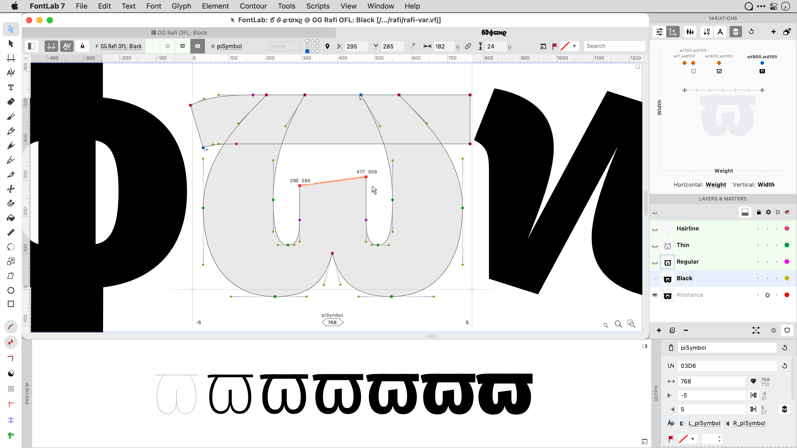

# GG Rafi OFL

<small>You can type in the box below to preview the font:</small>

ÓSITEV TÛĒRGD speaker âdłamÿ ðèʼnzæy

[Download FontLab VFJ](https://cdn.jsdelivr.net/gh/fontlabcom/getgo-fonts/getgo-fonts/ofl/rafi/rafi-var.vfj){: .md-button .md-button--primary target="_blank" }

license: OFL \| Legible sanserif for UIs and signage with a weight axis, italic version \| glyphs: 2702 \| scripts: Latin, Greek, Cyrillic

---

{: .fancybox data-caption='GG Rafi OFL' data-fancybox='getgo'}

# GG Rafi OFL

GG Rafi OFL is a legible sanserif design suitable for user interfaces and signage in the Latin, Cyrillic and Greek scripts. It is variable in weight.

It contains 2702 glyphs and 22 OpenType features, and supports 1694 characters from the Unicode blocks: Cyrillic, Greek Extended, Latin Extended-B, Latin Extended Additional, Latin Extended-A, Greek and Coptic, Basic Latin, Latin-1 Supplement, IPA Extensions, Combining Diacritical Marks, Cyrillic Supplement, Spacing Modifier Letters, General Punctuation, Superscripts and Subscripts, Mathematical Operators, Arrows, Latin Extended-D, Number Forms, Phonetic Extensions, Latin Extended-C, Combining Diacritical Marks Supplement, Letterlike Symbols, Currency Symbols, Miscellaneous Technical, Private Use Area, Miscellaneous Symbols and Arrows, Phonetic Extensions Supplement, Geometric Shapes, Alphabetic Presentation Forms, Dingbats, Miscellaneous Mathematical Symbols-B, Latin Extended-E, Arabic Presentation Forms-B, Miscellaneous Symbols and Pictographs.

### License

Based on [Firava](https://github.com/hellogreg/firava) produced by Greg Gibson, which is based on [Fira Sans](https://github.com/mozilla/Fira) by Carrois Corporate & Edenspiekermann AG for the Mozilla Foundation and Telefonica S.A.

Digitized data copyright 2012-2015 The Mozilla Foundation and Telefonica S.A. Licensed under the [SIL Open Font License, Version 1.1](https://scripts.sil.org/OFL).

### Using this font

You may create your own fonts based on this font, and you may incorporate portions of this font into your own font, but you must publish the resulting font under the same license (SIL Open Font License, Version 1.1):

- in _Font Info › Legal › Copyright_, include `Portions Copyright 2012-2015 The Mozilla Foundation and Telefonica S.A.`
- in _Font Info › Legal › License_, put `Licensed under the SIL Open Font License, Version 1.1.`
- see [the license](https://scripts.sil.org/OFL) for more details

---

## Character map

! " $ % & ' ( ) * + , - . / : ; < = > ? @ A B C D E F G H I J K L M N O P Q R S T U V W X Y Z [ \ ] ^ _ ` a b c d e f g h i j k l m n o p q r s t u v w x y z { | } ~   ¡ ¢ £ ¤ ¥ ¦ § ¨ © ª « ¬ ® ¯ ° ± ´ µ ¶ · ¸ º » ¿ À Á Â Ã Ä Å Æ Ç È É Ê Ë Ì Í Î Ï Ð Ñ Ò Ó Ô Õ Ö × Ø Ù Ú Û Ü Ý Þ ß à á â ã ä å æ ç è é ê ë ì í î ï ð ñ ò ó ô õ ö ÷ ø ù ú û ü ý þ ÿ Ā ā Ă ă Ą ą Ć ć Ĉ ĉ Ċ ċ Č č Ď ď Đ đ Ē ē Ĕ ĕ Ė ė Ę ę Ě ě Ĝ ĝ Ğ ğ Ġ ġ Ģ ģ Ĥ ĥ Ħ ħ Ĩ ĩ Ī ī Ĭ ĭ Į į İ ı IJ ij Ĵ ĵ Ķ ķ ĸ Ĺ ĺ Ļ ļ Ľ ľ Ŀ ŀ Ł ł Ń ń Ņ ņ Ň ň ʼn Ŋ ŋ Ō ō Ŏ ŏ Ő ő Œ œ Ŕ ŕ Ŗ ŗ Ř ř Ś ś Ŝ ŝ Ş ş Š š Ţ ţ Ť ť Ŧ ŧ Ũ ũ Ū ū Ŭ ŭ Ů ů Ű ű Ų ų Ŵ ŵ Ŷ ŷ Ÿ Ź ź Ż ż Ž ž ƀ Ɓ Ƃ ƃ Ƅ ƅ Ɔ Ƈ ƈ Ɖ Ɗ Ƌ ƌ ƍ Ǝ Ə Ɛ Ƒ ƒ Ɠ Ɣ ƕ Ɩ Ɨ Ƙ ƙ ƚ ƛ Ɯ Ɲ ƞ Ɵ Ơ ơ Ƣ ƣ Ƥ ƥ Ʀ Ƨ ƨ Ʃ ƪ ƫ Ƭ ƭ Ʈ Ư ư Ʊ Ʋ Ƴ ƴ Ƶ ƶ Ʒ Ƹ ƹ ƺ ƻ Ƽ ƽ ƾ ƿ ǀ ǁ ǂ ǃ DŽ Dž dž LJ Lj lj NJ Nj nj Ǎ ǎ Ǐ ǐ Ǒ ǒ Ǔ ǔ Ǖ ǖ Ǘ ǘ Ǚ ǚ Ǜ ǜ ǝ Ǟ ǟ Ǡ ǡ Ǣ ǣ Ǥ ǥ Ǧ ǧ Ǩ ǩ Ǫ ǫ Ǭ ǭ Ǯ ǯ ǰ DZ Dz dz Ǵ ǵ Ƕ Ƿ Ǹ ǹ Ǻ ǻ Ǽ ǽ Ǿ ǿ Ȁ ȁ Ȃ ȃ Ȅ ȅ Ȇ ȇ Ȉ ȉ Ȋ ȋ Ȍ ȍ Ȏ ȏ Ȑ ȑ Ȓ ȓ Ȕ ȕ Ȗ ȗ Ș ș Ț ț Ȝ ȝ Ȟ ȟ Ƞ ȡ Ȣ ȣ Ȥ ȥ Ȧ ȧ Ȩ ȩ Ȫ ȫ Ȭ ȭ Ȯ ȯ Ȱ ȱ Ȳ ȳ ȴ ȵ ȶ ȷ ȸ ȹ Ⱥ Ȼ ȼ Ƚ Ⱦ ȿ ɀ Ɂ ɂ Ƀ Ʉ Ʌ Ɇ ɇ Ɉ ɉ Ɋ ɋ Ɍ ɍ Ɏ ɏ ɐ ɑ ɒ ɓ ɔ ɕ ɖ ɗ ɘ ə ɚ ɛ ɜ ɝ ɞ ɟ ɠ ɡ ɢ ɣ ɤ ɥ ɦ ɧ ɨ ɩ ɪ ɫ ɬ ɭ ɮ ɯ ɰ ɱ ɲ ɳ ɴ ɵ ɶ ɷ ɸ ɹ ɺ ɻ ɼ ɽ ɾ ɿ ʀ ʁ ʂ ʃ ʄ ʅ ʆ ʇ ʈ ʉ ʊ ʋ ʌ ʍ ʎ ʏ ʐ ʑ ʒ ʓ ʔ ʕ ʖ ʗ ʘ ʙ ʚ ʛ ʜ ʝ ʞ ʟ ʠ ʡ ʢ ʣ ʤ ʥ ʦ ʧ ʨ ʩ ʪ ʫ ʬ ʭ ʮ ʯ ʰ ʱ ʲ ʴ ʷ ʸ ʹ ʺ ʻ ʼ ʿ ˀ ˆ ˇ ˈ ˊ ˋ ˌ ˎ ˏ ː ˑ ˔ ˖ ˗ ˘ ˙ ˚ ˛ ˜ ˝ ˞ ˠ ˡ ˢ ˣ ˤ ˥ ˦ ˧ ˨ ˩ ˮ ̀ ́ ̂ ̃ ̄ ̆ ̇ ̈ ̉ ̊ ̋ ̌ ̍ ̏ ̑ ̒ ̓ ̖ ̗ ̘ ̙ ̚ ̛ ̜ ̝ ̞ ̟ ̠ ̡ ̣ ̤ ̥ ̦ ̧ ̨ ̩ ̪ ̫ ̬ ̭ ̯ ̰ ̱ ̲ ̴ ̵ ̶ ̹ ̺ ̻ ̼ ̽ ͂ ͅ ͜ ͡ Ͱ ͱ Ͳ ͳ ʹ ͵ Ͷ ͷ ͺ ͻ ͼ ͽ ; Ϳ ΄ ΅ Ά · Έ Ή Ί Ό Ύ Ώ ΐ Α Β Γ Δ Ε Ζ Η Θ Ι Κ Λ Μ Ν Ξ Ο Π Ρ Σ Τ Υ Φ Χ Ψ Ω Ϊ Ϋ ά έ ή ί ΰ α β γ δ ε ζ η θ ι κ λ μ ν ξ ο π ρ ς σ τ υ φ χ ψ ω ϊ ϋ ό ύ ώ Ϗ ϐ ϑ ϒ ϓ ϔ ϕ ϖ ϗ Ϙ ϙ Ϛ ϛ Ϝ ϝ Ϟ ϟ Ϡ ϡ ϰ ϱ ϲ ϳ ϴ ϵ ϶ Ϸ ϸ Ϲ Ϻ ϻ ϼ Ͻ Ͼ Ͽ Ѐ Ё Ђ Ѓ Є Ѕ І Ї Ј Љ Њ Ћ Ќ Ѝ Ў Џ А Б В Г Д Е Ж З И Й К Л М Н О П Р С Т У Ф Х Ц Ч Ш Щ Ъ Ы Ь Э Ю Я а б в г д е ж з и й к л м н о п р с т у ф х ц ч ш щ ъ ы ь э ю я ѐ ё ђ ѓ є ѕ і ї ј љ њ ћ ќ ѝ ў џ Ѡ ѡ Ѣ ѣ Ѥ ѥ Ѧ ѧ Ѩ ѩ Ѫ ѫ Ѭ ѭ Ѯ ѯ Ѱ ѱ Ѳ ѳ Ѵ ѵ Ѷ ѷ Ѹ ѹ Ҋ ҋ Ҍ ҍ Ҏ ҏ Ґ ґ Ғ ғ Ҕ ҕ Җ җ Ҙ ҙ Қ қ Ҝ ҝ Ҟ ҟ Ҡ ҡ Ң ң Ҥ ҥ Ҧ ҧ Ҩ ҩ Ҫ ҫ Ҭ ҭ Ү ү Ұ ұ Ҳ ҳ Ҵ ҵ Ҷ ҷ Ҹ ҹ Һ һ Ҽ ҽ Ҿ ҿ Ӏ Ӂ ӂ Ӄ ӄ Ӆ ӆ Ӈ ӈ Ӊ ӊ Ӌ ӌ Ӎ ӎ ӏ Ӑ ӑ Ӓ ӓ Ӕ ӕ Ӗ ӗ Ә ә Ӛ ӛ Ӝ ӝ Ӟ ӟ Ӡ ӡ Ӣ ӣ Ӥ ӥ Ӧ ӧ Ө ө Ӫ ӫ Ӭ ӭ Ӯ ӯ Ӱ ӱ Ӳ ӳ Ӵ ӵ Ӷ ӷ Ӹ ӹ Ӻ ӻ Ӽ ӽ Ӿ ӿ Ԁ ԁ Ԃ ԃ Ԅ ԅ Ԇ ԇ Ԉ ԉ Ԋ ԋ Ԍ ԍ Ԏ ԏ Ԑ ԑ Ԓ ԓ Ԕ ԕ Ԗ ԗ Ԙ ԙ Ԛ ԛ Ԝ ԝ Ԟ ԟ Ԡ ԡ Ԣ ԣ Ԥ ԥ Ԧ ԧ Ԩ ԩ Ԫ ԫ Ԭ ԭ Ԯ ԯ ᵊ ᵬ ᵭ ᵮ ᵯ ᵰ ᵱ ᵲ ᵳ ᵴ ᵵ ᵶ ᶑ ᶿ ᷄ ᷅ ᷆ ᷇ ᷈ ᷉ Ḃ ḃ Ḅ ḅ Ḋ ḋ Ḍ ḍ Ḏ ḏ Ḓ ḓ Ḟ ḟ Ḥ ḥ Ḯ ḯ Ḷ ḷ Ḽ ḽ Ḿ ḿ Ṁ ṁ Ṅ ṅ Ṇ ṇ Ṋ ṋ Ṍ ṍ Ṑ ṑ Ṓ ṓ Ṕ ṕ Ṗ ṗ Ṛ ṛ Ṡ ṡ Ṣ ṣ Ṫ ṫ Ṭ ṭ Ṯ ṯ Ṱ ṱ Ṹ ṹ Ẁ ẁ Ẃ ẃ Ẅ ẅ Ẓ ẓ ẞ Ạ ạ Ả ả Ấ ấ Ầ ầ Ẩ ẩ Ẫ ẫ Ậ ậ Ắ ắ Ằ ằ Ẳ ẳ Ẵ ẵ Ặ ặ Ẹ ẹ Ẻ ẻ Ẽ ẽ Ế ế Ề ề Ể ể Ễ ễ Ệ ệ Ỉ ỉ Ị ị Ọ ọ Ỏ ỏ Ố ố Ồ ồ Ổ ổ Ỗ ỗ Ộ ộ Ớ ớ Ờ ờ Ở ở Ỡ ỡ Ợ ợ Ụ ụ Ủ ủ Ứ ứ Ừ ừ Ử ử Ữ ữ Ự ự Ỳ ỳ Ỵ ỵ Ỷ ỷ Ỹ ỹ ἀ ἁ ἂ ἃ ἄ ἅ ἆ ἇ Ἀ Ἁ Ἂ Ἃ Ἄ Ἅ Ἆ Ἇ ἐ ἑ ἒ ἓ ἔ ἕ Ἐ Ἑ Ἒ Ἓ Ἔ Ἕ ἠ ἡ ἢ ἣ ἤ ἥ ἦ ἧ Ἠ Ἡ Ἢ Ἣ Ἤ Ἥ Ἦ Ἧ ἰ ἱ ἲ ἳ ἴ ἵ ἶ ἷ Ἰ Ἱ Ἲ Ἳ Ἴ Ἵ Ἶ Ἷ ὀ ὁ ὂ ὃ ὄ ὅ Ὀ Ὁ Ὂ Ὃ Ὄ Ὅ ὐ ὑ ὒ ὓ ὔ ὕ ὖ ὗ Ὑ Ὓ Ὕ Ὗ ὠ ὡ ὢ ὣ ὤ ὥ ὦ ὧ Ὠ Ὡ Ὢ Ὣ Ὤ Ὥ Ὦ Ὧ ὰ ά ὲ έ ὴ ή ὶ ί ὸ ό ὺ ύ ὼ ώ ᾀ ᾁ ᾂ ᾃ ᾄ ᾅ ᾆ ᾇ ᾈ ᾉ ᾊ ᾋ ᾌ ᾍ ᾎ ᾏ ᾐ ᾑ ᾒ ᾓ ᾔ ᾕ ᾖ ᾗ ᾘ ᾙ ᾚ ᾛ ᾜ ᾝ ᾞ ᾟ ᾠ ᾡ ᾢ ᾣ ᾤ ᾥ ᾦ ᾧ ᾨ ᾩ ᾪ ᾫ ᾬ ᾭ ᾮ ᾯ ᾰ ᾱ ᾲ ᾳ ᾴ ᾶ ᾷ Ᾰ Ᾱ Ὰ Ά ᾼ ᾽ ι ᾿ ῀ ῁ ῂ ῃ ῄ ῆ ῇ Ὲ Έ Ὴ Ή ῌ ῍ ῎ ῏ ῐ ῑ ῒ ΐ ῖ ῗ Ῐ Ῑ Ὶ Ί ῝ ῞ ῟ ῠ ῡ ῢ ΰ ῤ ῥ ῦ ῧ Ῠ Ῡ Ὺ Ύ Ῥ ῭ ΅ ` ῲ ῳ ῴ ῶ ῷ Ὸ Ό Ὼ Ώ ῼ ´ ῾     ‒ – — ― ‖ ‘ ’ ‚ “ ” „ † ‡ • … ‰ ‹ › ‿ ⁄ ⁊ ⁺ ⁻ ⁼ ⁽ ⁾ ⁿ ₊ ₋ ₌ ₍ ₎ € ₯ ₹ ₺ ₽ ℊ ℓ № ™ Ω ℮ ← ↑ → ↓ ↔ ↕ ↖ ↗ ↘ ↙ ⇦ ⇧ ⇨ ⇩ ⇪ ∂ ∅ ∆ ∏ ∑ − ∕ ∙ √ ∞ ∫ ≈ ≠ ≤ ≥ ⋅ ⌦ ⌧ ⌨ ⌫ ⏎ ▯ ◊ ➡ ⦙ ⬅ ⬆ ⬇ Ɽ ⱥ ⱦ Ɑ ⱱ Ⱳ ⱳ ꞉ ꞊ Ꞌ ꞌ Ɥ Ɦ Ɬ Ɪ Ʝ Ꭓ Ꞵ ꞵ Ꞷ ꞷ ꭓ fi fl 🌐

